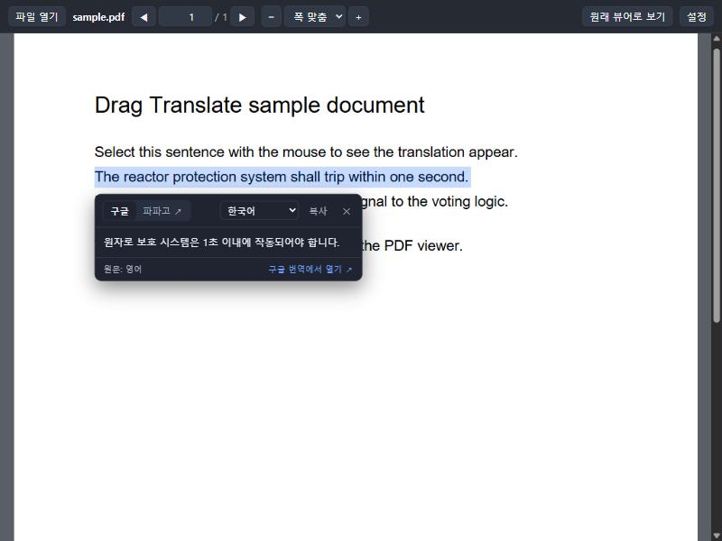

# 드래그 번역 (drag-translate)

웹 페이지와 **PDF**에서 글자를 마우스로 드래그하면 그 자리에서 번역해 주는 **크롬 확장 프로그램**입니다.

- **구글 번역**: 선택한 글 바로 아래에 번역 창이 뜹니다. 키나 가입이 필요 없습니다.
- **파파고**: 번역 창의 「파파고에서 번역 보기」를 누르면 파파고 사이트가 새 탭으로 열리고, 고른 글이 미리 채워져 있습니다.
- **PDF**: PDF를 열면 확장에 들어 있는 **PDF 번역 뷰어**(Mozilla PDF.js)로 열립니다. 쪽 안의 글자를 드래그하면 똑같이 번역됩니다.



---

## 목차

1. [설치 방법](#설치-방법)
2. [사용 방법](#사용-방법)
3. [설정](#설정)
4. [동작 원리와 개인정보](#동작-원리와-개인정보)
5. [알아 둘 점](#알아-둘-점)
6. [문제 해결](#문제-해결)
7. [개발](#개발)

---

## 설치 방법

크롬 웹 스토어에 올리지 않은 확장이라 **「압축해제된 확장 프로그램」으로 직접 설치**합니다. 5분이면 됩니다.
크롬 120 이상에서 동작하고, 같은 바탕인 엣지와 웨일에서도 됩니다.

### 1. 파일 받기

둘 중 하나를 고르세요.

- **ZIP으로 받기**: 이 페이지 위쪽의 초록색 **`Code`** 단추 → **`Download ZIP`** → 받은 파일의 압축을 풉니다.
  예: `D:\tools\drag-translate-main` (이 폴더 안에 `manifest.json`이 바로 보여야 합니다)
- **git으로 받기**
  ```bash
  git clone https://github.com/sheryloe/drag-translate.git
  ```

> 설치한 뒤에 이 폴더를 지우거나 옮기면 확장이 사라집니다. 지워지지 않을 곳에 두세요.

### 2. 크롬에 올리기

1. 주소창에 **`chrome://extensions`** 를 입력해 확장 프로그램 관리 화면을 엽니다.
2. 오른쪽 위 **「개발자 모드」** 를 켭니다.
3. 왼쪽 위 **「압축해제된 확장 프로그램을 로드합니다」** 를 누릅니다.
4. 1단계에서 받은 폴더(`manifest.json`이 들어 있는 폴더)를 고르고 **「폴더 선택」** 을 누릅니다.
5. 목록에 **「드래그 번역 (Drag Translate)」** 이 나타나면 설치가 끝난 것입니다. 설정 화면이 한 번 자동으로 열립니다.
6. 주소창 오른쪽의 퍼즐 모양 아이콘 → 「드래그 번역」 옆 **핀(📌)** 을 누르면 도구 막대에 아이콘이 고정됩니다.

### 3. (선택) 내 컴퓨터의 PDF도 쓰려면

`file:///C:/…/문서.pdf`처럼 **내 컴퓨터의 PDF 파일**을 번역 뷰어로 열려면 권한을 하나 더 켜야 합니다.

1. `chrome://extensions` → 「드래그 번역」의 **「세부정보」**
2. **「파일 URL에 대한 액세스 허용」** 을 켭니다.

이 권한을 켜지 않아도, 번역 뷰어의 **「파일 열기」**로 같은 파일을 고르거나 창에 끌어 놓으면 볼 수 있습니다.

### 엣지·웨일에서 설치

- 엣지: `edge://extensions` → 왼쪽 아래 「개발자 모드」 → 「압축 풀린 항목 로드」 → 폴더 선택
- 웨일: `whale://extensions` → 「개발자 모드」 → 「압축해제된 확장앱을 로드합니다」 → 폴더 선택

### 업데이트

새 버전을 받아 같은 폴더에 덮어씁니다(git이면 `git pull`). 그다음 `chrome://extensions`에서 「드래그 번역」의 **새로고침(⟳)** 아이콘을 누르세요.
이미 열려 있던 탭은 새로 고쳐야 새 버전이 붙습니다.

---

## 사용 방법

### 웹 페이지

1. 번역하고 싶은 글을 마우스로 **드래그**합니다. 두 번 눌러 낱말 하나를 골라도 됩니다.
2. 선택 바로 아래에 **번역 창**이 뜹니다.

| 번역 창에서 | 하는 일 |
|---|---|
| **구글** / **파파고 ↗** | 번역 엔진을 바꿉니다. 고른 엔진은 다음에도 기본값으로 남습니다. |
| 언어 고르기(한국어 ▾) | 번역할 언어를 바꿉니다(13개 언어, 아래 [설정](#설정) 참고). 원문 언어는 자동으로 알아냅니다. |
| **복사** | 번역문을 클립보드에 복사합니다. |
| **✕** 또는 **Esc** | 창을 닫습니다. 창 밖을 눌러도 닫힙니다. |
| 구글 번역에서 열기 ↗ | 같은 글을 구글 번역 사이트에서 엽니다. |

**파파고**를 고르면 번역 창에 고른 글과 **「파파고에서 번역 보기 ↗」** 단추가 보입니다. 누르면 파파고가 새 탭에서 번역합니다.
파파고는 결과를 그 자리로 받아 올 무료 통로가 없어서 새 탭으로 엽니다. 드래그할 때마다 탭이 열리지 않도록 단추를 한 번 누르게 했습니다.

### PDF

- **PDF 주소를 열면** 크롬 기본 뷰어 대신 **PDF 번역 뷰어**로 열립니다. 쪽 안의 글자를 드래그하면 웹 페이지와 똑같이 번역됩니다.
- 위쪽 막대에는 「파일 열기」, 쪽 이동(◀ 쪽 번호 ▶), 확대·축소(− 폭 맞춤 +), 「원래 뷰어로 보기」, 「설정」이 있습니다.
- PDF **링크를 우클릭**하면 「이 PDF를 번역 뷰어로 열기」가 나옵니다.
- 이미 크롬 기본 뷰어로 열린 PDF는 도구 막대의 확장 아이콘 → 「이 PDF를 번역 뷰어로 열기」로 옮깁니다.
- 내 컴퓨터의 PDF는 확장 아이콘 → 「PDF 파일 열기」를 누르거나, 번역 뷰어 창에 파일을 **끌어 놓습니다**.
- 로그인이 필요한 문서처럼 크롬 기본 뷰어를 써야 할 때는 「원래 뷰어로 보기」를 누릅니다. 그 문서는 이번 브라우저 실행 동안 번역 뷰어로 자동 전환되지 않습니다.
  크롬 기본 뷰어 안에서도 글자를 고른 뒤 **우클릭 → 「구글로 번역」** 을 누르면 작은 결과 창으로 번역을 볼 수 있습니다.

### 우클릭 메뉴

글자를 고르고 우클릭하면 다음 메뉴가 있습니다.

- **구글로 번역: “…”**: 선택 옆(또는 작은 결과 창)에 구글 번역을 띄웁니다.
- **파파고에서 번역: “…”**: 파파고 사이트를 새 탭으로 엽니다.

### 도구 막대 아이콘(팝업)

켜기·끄기, 번역 엔진, 번역할 언어를 바로 바꾸고, 지금 탭의 PDF를 번역 뷰어로 열 수 있습니다. 「설정 더 보기」를 누르면 전체 설정이 열립니다.

---

## 설정

`chrome://extensions` → 「드래그 번역」 → 「확장 프로그램 옵션」을 누르거나, 팝업의 「설정 더 보기」를 누릅니다. 바꾸는 즉시 저장됩니다.

| 설정 | 기본값 | 설명 |
|---|---|---|
| 드래그 번역 켜기 | 켜짐 | 끄면 드래그해도 번역 창이 뜨지 않습니다. 우클릭 메뉴는 그대로 남습니다. |
| 번역 엔진 | 구글 바로 | 구글은 선택 옆에 바로 번역하고, 파파고는 단추를 눌러 새 탭으로 엽니다. |
| 번역할 언어 | 한국어 | 한국어, 영어, 일본어, 중국어(간체·번체), 베트남어, 태국어, 인도네시아어, 프랑스어, 스페인어, 러시아어, 독일어, 이탈리아어. 원문 언어는 자동으로 알아냅니다. |
| 번역 띄우는 때 | 드래그 즉시 | 「아이콘 눌러서」를 고르면 드래그 끝에 작은 「번」 단추만 뜨고, 눌러야 번역합니다. 실수로 드래그해도 번역 요청이 나가지 않습니다. |
| 최소 글자 수 | 2 | 이보다 짧게 고른 글은 번역하지 않습니다. |
| 입력칸 안의 선택은 무시 | 켜짐 | 글을 쓰는 중에 번역 창이 뜨지 않게 합니다. |
| PDF를 번역 뷰어로 열기 | 켜짐 | 주소가 `.pdf`로 끝나는 문서를 번역 뷰어로 엽니다. 끄면 크롬 기본 뷰어에서 우클릭 번역을 쓰세요. |

설정은 크롬 계정의 동기화 저장소(`chrome.storage.sync`)에 저장되어, 같은 계정으로 로그인한 다른 PC에도 따라갑니다.

---

## 동작 원리와 개인정보

- 드래그한 글은 **번역할 때만** 구글 번역 서버(`translate.googleapis.com`)로 보냅니다. 페이지 전체나 방문 기록은 보내지 않습니다.
- 파파고는 `papago.naver.com`을 새 탭으로 여는 것뿐이고, 확장이 파파고 서버로 직접 요청하지 않습니다.
- 번역 결과는 저장하지 않습니다. 브라우저가 켜져 있는 동안 같은 글을 다시 고르면 메모리에 둔 결과를 다시 씁니다.
- 외부 분석·광고 코드가 없습니다. PDF.js는 확장 안에 들어 있어 따로 내려받지 않습니다.

| 권한 | 왜 필요한가 |
|---|---|
| `storage` | 설정 저장 |
| `contextMenus` | 우클릭 메뉴(「구글로 번역」, 「파파고에서 번역」, 「이 PDF를 번역 뷰어로 열기」) |
| `declarativeNetRequest` | `.pdf` 주소를 번역 뷰어로 돌리기(「PDF를 번역 뷰어로 열기」 설정이 켜져 있을 때만) |
| 모든 사이트 접근(`<all_urls>`) | 어느 페이지에서든 드래그를 감지하고, 번역 뷰어가 다른 사이트의 PDF를 불러오기 위해 |

> **회사 문서 주의**: 드래그한 글은 외부 번역 서버로 나갑니다. 사내 보안 규정상 밖으로 보내면 안 되는 문서를 볼 때는 팝업의 스위치로 확장을 꺼 두세요.

---

## 알아 둘 점

- **구글 번역**은 구글 번역 사이트가 쓰는 공개 통로를 키 없이 씁니다. 짧은 시간에 아주 많이 요청하면 잠시 막힐 수 있고, 그때는 「요청이 너무 잦아…」 안내가 뜹니다. 잠시 뒤 다시 하거나 「구글 번역에서 열기」를 쓰세요.
- 한 번에 **5,000자**까지 번역합니다. 더 길면 앞 5,000자만 번역하고 그렇다고 알립니다.
- **크롬 기본 PDF 뷰어** 안에서는 크롬이 확장에게 선택한 글을 보여 주지 않습니다. 그래서 PDF는 번역 뷰어로 열거나, 기본 뷰어에서는 우클릭 「구글로 번역」을 씁니다.
- **스캔한 PDF**처럼 글자가 아니라 그림으로 된 쪽은 고를 글자가 없어 번역할 수 없습니다.
- `chrome://` 화면, 크롬 웹 스토어, 다른 확장의 화면에서는 크롬 정책상 동작하지 않습니다.
- 주소가 `.pdf`로 끝나지 않는 PDF(다운로드 주소 등)는 자동으로 번역 뷰어로 가지 않습니다. 열린 뒤 팝업의 「이 PDF를 번역 뷰어로 열기」를 쓰세요.

---

## 문제 해결

| 증상 | 해결 |
|---|---|
| 드래그해도 아무것도 안 뜬다 | ① 팝업에서 스위치가 켜져 있는지 봅니다. ② 설치·업데이트 전부터 열려 있던 탭이면 **새로 고칩니다**. ③ 입력칸 안이라면 설정 「입력칸 안의 선택은 무시」를 끕니다. |
| 「확장 프로그램이 다시 로드되었습니다」가 뜬다 | 확장을 새로 고치기 전부터 열려 있던 탭입니다. 탭을 새로 고치세요. |
| PDF가 번역 뷰어로 안 열린다 | 설정 「PDF를 번역 뷰어로 열기」가 켜져 있는지, 주소가 `.pdf`로 끝나는지 봅니다. 아니면 팝업의 「이 PDF를 번역 뷰어로 열기」를 누릅니다. |
| 번역 뷰어에 「PDF를 불러오지 못했습니다」가 뜬다 | 로그인이 필요한 사이트의 PDF일 수 있습니다. 「원래 뷰어로 보기」를 누른 뒤 우클릭 번역을 쓰세요. 내 컴퓨터 파일이면 [3단계](#3-선택-내-컴퓨터의-pdf도-쓰려면) 권한을 켜거나 「파일 직접 열기」를 누릅니다. |
| 한글·한자가 깨진 PDF | 번역 뷰어에는 PDF.js의 글꼴 지도(cMaps)가 들어 있습니다. 그래도 깨지면 PDF 자체에 글자 정보가 없는 경우입니다. |
| 번역 창이 페이지 모양과 섞인다 | 번역 창은 페이지와 분리된 그림자 DOM에 그려집니다. 재현되는 주소를 이슈로 알려 주세요. |

---

## 개발

빌드 과정이 없는 순수 자바스크립트 확장입니다. 받은 폴더를 그대로 크롬에 올리면 됩니다.

```
manifest.json              확장 정의(매니페스트 3판)
src/background.js          서비스 워커: 구글 번역 요청, 우클릭 메뉴, PDF 자동 열기 규칙
src/shared/config.js       설정 기본값·검증·저장
src/shared/engines.js      구글 요청·응답, 파파고·구글 웹 주소
src/shared/pdf-url.js      PDF 주소 판단, 뷰어 주소 만들기·읽기
src/shared/bridge.js       화면에서 서비스 워커로 보내는 요청
src/ui/card.js             번역 창과 드래그 감지(웹 페이지·PDF 뷰어·결과 창 공용)
src/content/content.js     웹 페이지에 붙는 콘텐츠 스크립트
src/pdf/                   PDF 번역 뷰어(PDF.js)
src/popup/  src/options/   도구 막대 팝업 · 설정 화면
src/result/                우클릭 번역 결과 창(크롬 기본 PDF 뷰어 등에서 씀)
vendor/pdfjs/              Mozilla PDF.js 6.4.299 배포 파일(Apache-2.0)
icons/                     아이콘(scripts/make-icons.mjs로 그림)
test/                      노드 시험
```

```bash
npm test          # 시험(노드 20 이상, 따로 설치할 것 없음)
npm install       # PDF.js를 새 버전으로 바꿀 때만
npm run vendor    # node_modules/pdfjs-dist → vendor/pdfjs 복사
npm run icons     # 아이콘 다시 그리기
```

코드를 고친 뒤에는 `chrome://extensions`에서 새로고침(⟳)을 누르고, 시험할 탭도 새로 고칩니다.
서비스 워커 기록은 확장 카드의 「서비스 워커」 링크에서, 번역 창과 뷰어 기록은 그 탭의 개발자 도구(F12)에서 봅니다.

## 라이선스

`vendor/pdfjs`의 PDF.js는 Mozilla의 [Apache License 2.0](vendor/pdfjs/LICENSE)을 따릅니다. wasm 디코더의 라이선스는 `vendor/pdfjs/wasm/LICENSE_*`에 있습니다.
